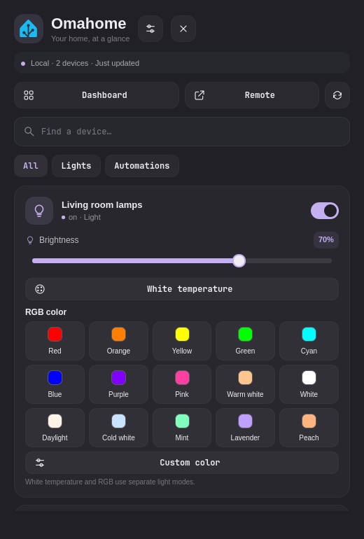

# Omahome

A native **Home Assistant** panel for the Omarchy desktop, by **Zizor**. Control connected devices from the bar, view room measurements, and open your local or remote Home Assistant dashboard.



*Example rendered from the actual panel with sample devices. Colors follow your Omarchy theme; available controls depend on your Home Assistant entities.*

## Features

| Device or function | Controls and readings |
| --- | --- |
| Lights | Power, brightness, white color temperature, one-click RGB presets, and custom RGB sliders with preview |
| Speakers | Volume, mute, media title, and supported power controls |
| Smart plugs and switches | Power and clearly labeled child-lock toggles with lock/unlock icons |
| Air purifiers | Power, speed, and advertised preset modes, including compatible Levoit models |
| Fans | Speed, presets, oscillation, and direction when supported; separate Fans category |
| Heating and AC | HVAC modes, temperature targets or heat/cool ranges, fan modes, and presets |
| Humidifiers and dehumidifiers | Power, target humidity, readings, and operating modes |
| Sensors | Temperature, humidity, air quality, and recognized filter-life readings |
| Covers and scenes | Open/stop/close and scene activation, including scenes without known activation history |
| Automations | Dedicated category, enable/disable, and run with conditions checked |

Entities are grouped by physical device, with search and category filters. Generic telemetry such as RSSI, uptime, and sun positions is hidden. Govee and other Bluetooth readings work through the entities already exposed by Home Assistant; Omahome does not scan Bluetooth itself.

## Requirements

- Omarchy Quattro with the plugin-capable shell, Quickshell, and Qt Quick Controls.
- Python 3.9 or newer. No additional Python or npm packages are required.
- A reachable Home Assistant server and a long-lived access token for an account allowed to control your devices.

## Installation

Install and enable Omahome directly from GitHub:

```bash
omarchy plugin add https://github.com/Z1Z0R/Omahome.git --enable
```

Follow Omarchy's prompts, then click the Home Assistant icon in the bar to configure your connection.

For installations added this way, get updates with:

```bash
omarchy plugin update zizor.omahome
```

### Manual installation

Alternatively, clone this repository or extract a release archive, open a terminal in its root directory, and run:

```bash
bash install.sh
```

The installer validates the plugin, installs it as `zizor.omahome`, and enables its Home Assistant icon on the right side of the bar.

To update an installation originally made with `install.sh`, run from the new checkout or extracted release:

```bash
bash install.sh --update
omarchy-restart-shell
```

Updates stage and validate the complete plugin before activation, preserve the old version in a backup, and restore it if activation fails. Your saved connection settings and bar position are preserved.

## Connect

1. Click the Home Assistant icon in the bar and open **Settings**.
2. Enter your local server URL, such as `http://homeassistant.local:8123`.
3. In Home Assistant, create a **Long-lived access token** from your profile's **Security** settings.
4. Paste the token into Omahome, choose **Local**, and click **Save and connect**.

Startup and opening the panel only load saved settings; they do not contact Home Assistant. On later openings, click **Connect to Home Assistant** to start a session. Closing the panel ends that session, cancels pending API work, and requires a fresh Connect action next time.

Local HTTP cannot authenticate the server: a private IP or `.local` hostname can identify a different device on another network. Connect over HTTP only on your trusted home network. Use HTTPS with a valid server certificate for server identity verification; an open HTTP session is not protected against network changes.

For remote use, enter an existing HTTPS root URL, select **Remote**, and save. **Open remotely** opens that dashboard in your browser. Home Assistant Cloud, an existing HTTPS tunnel, or a reverse proxy can provide external access; Omahome does not create a tunnel or public hostname. Browser login is separate from API token authentication, and a proxy login gate may block API requests.

See the [usage guide](docs/usage.md) for device support, remote access, troubleshooting, and connection details.

## RGB lights and automations

Color-capable lamps show an **RGB color** section directly on the card, with one-click Red, Orange, Yellow, Green, Cyan, Blue, Purple, Pink, Warm white, White, Daylight, Cold white, Mint, Lavender, and Peach presets. Click a preset to apply it immediately. **Custom color** opens the RGB sliders, preview, and **Apply RGB color** button. White presets are RGB approximations. White-temperature controls have their own button. Unsent custom RGB edits are preserved during refreshes. After sending a color, the preview and preset selection follow the state confirmed by Home Assistant on the next refresh. RGB, RGBW, RGBWW, HS, and XY color modes are recognized; non-color lamps do not show RGB controls.

The **Automations** category lists Home Assistant automation entities. The toggle enables or disables future automatic triggers; disabling leaves an active run going. **Run now** checks the automation's conditions and can also be used while automatic triggers are disabled. Conditions that depend on a particular trigger may prevent a manual run. Edit triggers, conditions, and actions in Home Assistant.

[View the Automations panel example](docs/images/automations-example.png).

## Child locks

Recognized child-lock switches show an emphasized **Child lock · Enabled/Disabled** status, a lock/unlock icon, and explanatory text. Their toggles operate the child-lock entity independently of device power. Configuration entities for recognized child locks remain visible. Detection uses entity names or IDs such as `child_lock`; a completely renamed entity without a matching hint may need a clearer name in Home Assistant.

## Credentials

The token is stored in `${XDG_CONFIG_HOME:-~/.config}/omahome/connection.json`, with directory permissions `700` and file permissions `600`. It is a private plaintext file, not an encrypted keyring. Do not commit it to Git.

HTTPS certificates are verified, redirects are rejected, and credentials are omitted from command arguments and error messages. Requests check device capabilities before sending commands. Other software running as your user can still access your files; revoke the token in Home Assistant when you stop using Omahome.

## Development

```bash
omarchy plugin validate .
python3 -m unittest discover -s tests -v
python3 tests/smoke_qml.py
```

The tests use isolated settings and mocked Home Assistant responses. The QML smoke test requires an installed Omarchy shell and Quickshell; it renders the actual controls offscreen with the compositor popup wrapper replaced. Live Wayland placement and physical device behavior need separate testing.

The repository contains the QML panel and controls, the standard-library Python bridge in `bin/bridge.py`, the installer, tests, and documentation. No background service is installed. After an explicit connection, the panel polls every ten seconds while open.

## Removal

```bash
omarchy plugin disable zizor.omahome
omarchy plugin remove zizor.omahome
```

Connection settings are retained. Revoke the access token and remove the dedicated connection file if you no longer need it.

## Author and license

**Zizor** · [MIT License](LICENSE)

The bundled Home Assistant logo retains its original attribution and Apache 2.0 license; see [the logo notice](assets/NOTICE-home-assistant.md). Home Assistant names and logos are trademarks of the Open Home Foundation. Omahome is an independent community plugin and is not an official Home Assistant product.
